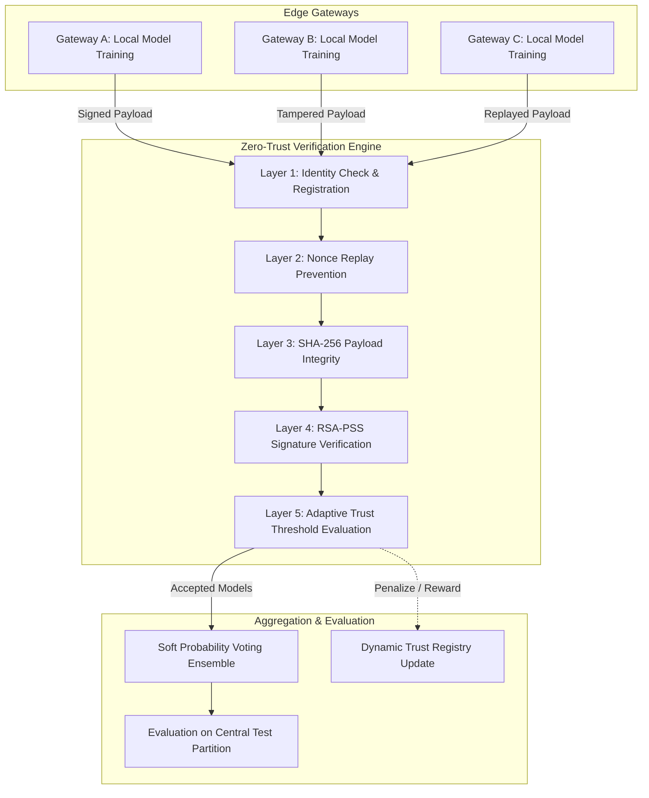

# ZTrust-FED: Zero-Trust Federated Learning Framework for IoT Intrusion Detection

[](https://www.python.org/downloads/)
[](https://csrc.nist.gov/publications/detail/sp/800-207/final)
[](https://opensource.org/licenses/MIT)

**ZTrust-FED** is a robust, privacy-preserving, and tamper-resilient Federated Learning (FL) framework designed for edge computing and Internet of Things (IoT) network intrusion detection. By enforcing a strict **"Never Trust, Always Verify"** zero-trust architectural paradigm, ZTrust-FED secures distributed machine learning against model poisoning, man-in-the-middle (MITM) tampering, replay attacks, and rogue node intrusions.

---

## Key Highlights

- **5-Layer Zero-Trust Verification Pipeline**: Every client update undergoes strict cryptographic identity checks, replay protection, SHA-256 hash integrity, RSA-PSS signature verification, and dynamic reputation scoring before admission.
- **Edge-to-Server Federated Architecture**: Simulates distributed edge gateways (e.g., Gateways A, B, and C) training localized models on partitioned network traffic, aggregated into a centralized soft-voting ensemble.
- **Out-of-Core Big Data Pipeline**: Handles multi-gigabyte network datasets (e.g., CICIoT2023) via out-of-core chunk streaming (`SGDClassifier` with incremental `partial_fit` and running standardizers) or in-memory `RandomForestClassifier`.
- **Dynamic Adaptive Trust Registry**: Implements historical decay, reinforcement rewards, and severe penalties for rogue nodes, gating aggregation using a configurable trust threshold.
- **Comprehensive Attack Test Suite**: Built-in verification demonstrating resilience against honest baselines, MITM weight manipulation, transaction replay, and rogue identity spoofing.

---

## Architectural Workflow



---

## The 5-Layer Security Pipeline

Before any model weight package enters the federated ensemble, it must satisfy five rigorous security verification layers:

1. **Layer 1: Identity & Authorization Check**
   - The server verifies if the `client_id` exists in the authorized client registry and possesses a registered RSA public key.
2. **Layer 2: Replay Protection**
   - Each payload requires a unique UUID4 `nonce`. The central trust registry maintains a history of consumed nonces per client and round to prevent replay attacks.
3. **Layer 3: Cryptographic Integrity Verification**
   - A SHA-256 digest is recomputed over the raw serialized model bytes. Any payload modification or bit-flipping during transit triggers immediate rejection.
4. **Layer 4: Digital Signature Verification**
   - Updates are signed using RSA-PSS (2048-bit key, SHA-256 hashing, MGF1 padding). The server verifies that the payload genuinely originated from the registered gateway's private key.
5. **Layer 5: Dynamic Adaptive Trust Evaluation**
   - Nodes maintain a reputation score $T \in [0, 100]$ governed by:
     $$T_{t+1} = \max\left(0, \min\left(100, \gamma \cdot T_t + (1 - A) \cdot R - A \cdot P\right)\right)$$
     where $\gamma = 0.95$ (decay factor), $R = 1.0$ (reward), $P = 25.0$ (penalty), and $A \in \{0, 1\}$ indicates verification failure. Gateways falling below the threshold ($T < 50.0$) are excluded from aggregation.

---

## Attack Scenarios & Evaluation

ZTrust-FED comes with end-to-end automated attack simulations:

| Case # | Scenario | Payload Details | Outcome | Triggered Defense |
| :--- | :--- | :--- | :--- | :--- |
| **Case 1** | **Honest Baseline** | Legitimate model signed by Gateway A | **ACCEPTED** | All 5 layers successfully validated |
| **Case 2** | **MITM Tampering** | Manipulated model weights en route | **REJECTED** | Layer 3 (Hash mismatch) / Layer 4 (Invalid signature) |
| **Case 3** | **Replay Attack** | Duplicate transmission of prior valid payload | **REJECTED** | Layer 2 (Replay: Nonce already consumed) |
| **Case 4** | **Rogue Node** | Unregistered gateway injecting poisoned weights | **REJECTED** | Layer 1 (Identity: Unregistered client) |

---

## Project Structure

```text
Major Project/
├── .gitignore               # Excludes multi-gigabyte raw datasets, partitions, & private keys
├── requirements.txt         # Project dependencies
├── README.md                # Project documentation and guide
├── archive/                 # Raw multi-part dataset files (optional / local)
└── main/
    ├── crypto_engine.py     # RSA-2048 key generation, SHA-256 hashing, RSA-PSS sign/verify
    ├── data_prep.py         # Out-of-core streaming partitioner and sample processor
    ├── gateway_client.py    # Edge gateway node logic, local training, and payload packaging
    ├── trust_registry.py    # Client trust scoring, mathematical decay/penalty, nonce tracking
    ├── server_ensemble.py   # Central verification engine, voting ensemble, and metric evaluation
    ├── run_demo.py          # End-to-end orchestration script with zero-trust test suite
    ├── keys/                # Directory storing PEM public/private keys
    └── data/
        ├── ciciot2023_sample.csv   # Fast development sample dataset
        └── partitions/             # Generated edge gateway CSV partitions (local only)
```

---

## Getting Started

### Prerequisites

- Python 3.8 or higher
- Git installed on your system

### 1. Installation

Clone or open the repository, create a virtual environment, and install dependencies:

```bash
# Create virtual environment
python -m venv venv

# Activate environment (Windows PowerShell)
.\venv\Scripts\Activate.ps1

# Activate environment (macOS/Linux)
# source venv/bin/activate

# Install dependencies
pip install -r requirements.txt
```

### 2. Running the Complete Demonstration

Run the master orchestration pipeline:

```bash
python main/run_demo.py
```

### 3. Pipeline Options & Command-Line Arguments

The framework supports multiple operational modes:

```bash
# Run with Random Forest on in-memory samples
python main/run_demo.py --model-type rf

# Force data regeneration with a custom sample size
python main/run_demo.py --rebuild-data --sample-size 50000

# Stream-process all raw multi-part archive CSVs (low RAM usage)
python main/run_demo.py --rebuild-data --streaming --max-files 10

# Ingest the entire multi-gigabyte archive via out-of-core online streaming
python main/run_demo.py --rebuild-data --full-dataset
```

---

## Evaluation Metrics

Upon successful verification, accepted gateway models are aggregated into an active voting ensemble and evaluated against the isolated test partition (`server_test.csv`):

- **Accuracy**: Overall classification rate on benign vs. attack traffic
- **Precision**: Proportion of true positive intrusions among detected attacks
- **Recall**: Detection rate of real attack vectors
- **F1-Score**: Harmonic mean of Precision and Recall

---

## License

This project is open-source and available under the [MIT License](LICENSE).
